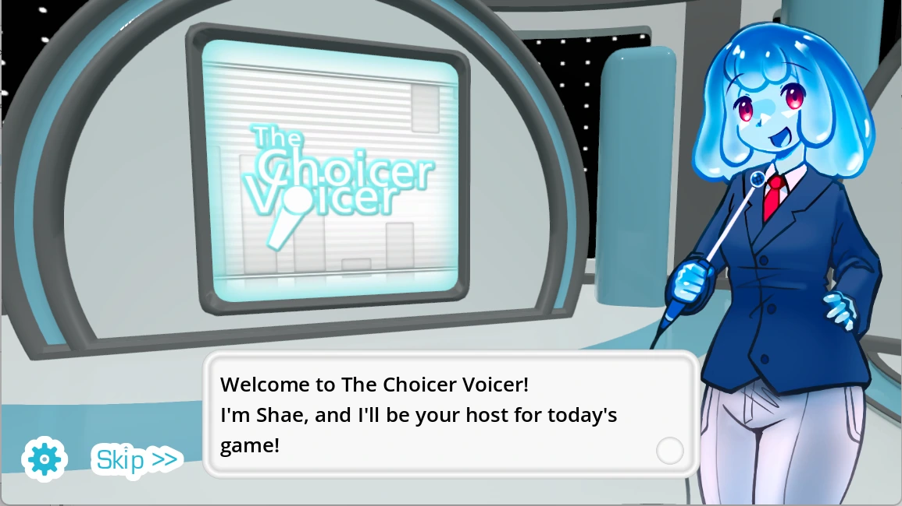
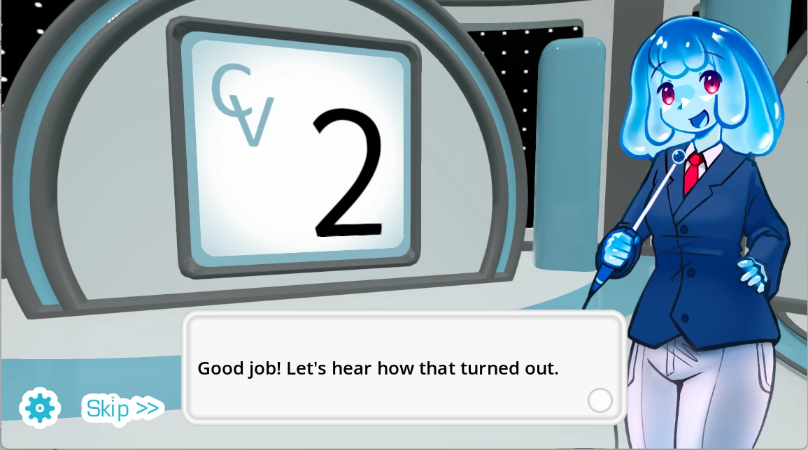
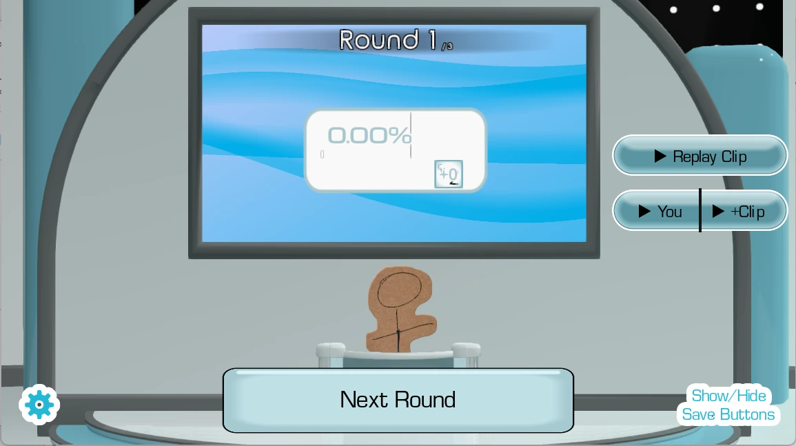

# The Choicer Voicer — Free Online Voice Party Game

**[Choicer Voicer Studio](https://choicervoicer.site/)** is a free browser portal for **The Choicer Voicer**, a microphone-powered party game where every prompt becomes a tiny performance. It also includes a dedicated **[Temple of the Jackal](https://choicervoicer.site/temple-of-the-jackal/)** page for adult players, with a restored 18-room rotation puzzle build, videos, illustrated guidance, and an unofficial post-expedition discussion.

## Play online free

Visit **[https://choicervoicer.site/](https://choicervoicer.site/)** and select **Start The Choicer Voicer**. The iframe loads only after this deliberate action, keeping the initial page lighter and ensuring microphone access is requested in context. No account or separate installer is required by the portal.

For reliable microphone selection, playback, and fullscreen behavior, use a current desktop version of Chrome or Edge. Headphones help prevent game audio from feeding back into the microphone.

## How a round works

1. Allow microphone access for the embedded game.
2. Listen to the prompt and choose a delivery.
3. Perform the line, hear the playback, and continue to the next round.

The fun comes from commitment rather than perfect imitation. Players can change pace, pitch, character, or emphasis, and local groups can pass the microphone between performers.

## Temple of the Jackal

Adult visitors can open **[Temple of the Jackal](https://choicervoicer.site/temple-of-the-jackal/)** from the compact Play More shelf or the shared top menu. Its page includes an age-gated restored game frame, two gameplay videos, an illustrated spoiler-light strategy guide, nine FAQs, and an unofficial post-expedition discussion. The game contains explicit sexual content and nudity and is intended only for players aged 18 or older.

## Make a voice session your own

The studio is built around the pleasure of hearing a familiar line become something unexpected. A convincing performance does not have to sound exactly like the original speaker. Try changing one element at a time: a slower opening, an exaggerated pause, a whisper followed by a confident finish, or a completely different emotional interpretation. Keeping the words recognizable while changing the delivery gives other listeners something concrete to react to.

Start with a short session rather than a large collection of unfamiliar clips. Listen carefully before speaking and leave a moment of silence at the beginning and end of your take. A quiet room helps you hear the difference between your intended delivery and what the microphone actually captures. If several people are playing together, agree on a comfortable speaking distance and let each performer finish before the group comments.

## Explore packs with a purpose

The pack directory gives visitors another way to discover material for a session. Browse a few entries, inspect the available descriptions and previews, and choose a theme that your group recognizes. A preview is useful context, not a promise that every clip will suit every audience. Consider language, tone and subject matter before introducing unfamiliar material to younger listeners or a mixed group.

A downloaded pack and a finished performance are different things. Follow the relevant pack page and the game's own import prompts instead of assuming that every file can be opened directly. Keep the original file available until you know that your chosen material works in your intended session. Where a preview is unavailable, do not treat its absence as evidence that the pack is empty or suitable for everyone.

## Practice without pressure

For a useful practice routine, repeat the same prompt with three different intentions. First read it naturally, then give it a dramatic interpretation, and finally try a deliberately understated version. Compare the results by listening rather than by focusing only on a score. Clear timing, consistent volume and an audible ending often make a performance easier to understand.

When playing socially, a simple rotation keeps the session welcoming. Give everyone a turn, allow a pass on uncomfortable material, and keep feedback about the performance rather than the person. Headphones are particularly helpful when replaying a take near a live microphone. Avoid recording other people without their agreement, and do not include personal information in a line you intend to share.

## Browser permissions and privacy

The microphone is a browser permission, not something that a README can grant. If a prompt does not appear or recording seems silent, check the browser's site permission and the selected input device. An operating-system mute switch or another application using the microphone may also affect the experience. Do not repeatedly reload while a take you want to keep is still on screen.

Read the current tool description before choosing media for transcription or another optional workflow. Different tools can have different processing requirements, and an older description should not override the notice next to the action you are about to take. Keep copies of anything important outside temporary browser playback. Clearing site data can remove locally retained preferences or history.

## Choose your next activity

Use the studio for a quick voice challenge, return to a familiar prompt for practice, or explore the directory when you want a new theme. Related game pages are separate experiences with their own controls and audience expectations. In particular, an adult-content notice is a meaningful boundary rather than a decoration: check it before opening or sharing that page.

This is an independent fan destination. Names and artwork identify the games and materials being discussed; they do not imply that the site owns those characters or speaks for their creators. The website's About, Privacy, Contact and Terms pages provide further context for visitors.
